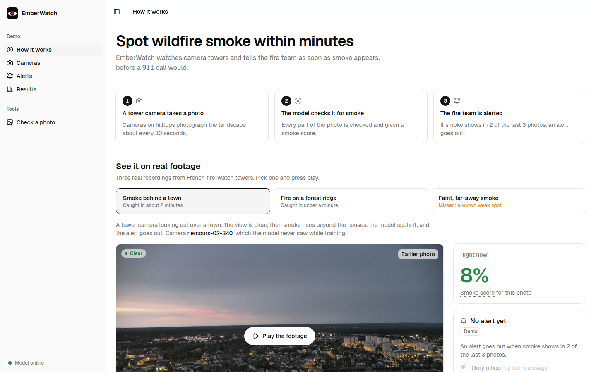
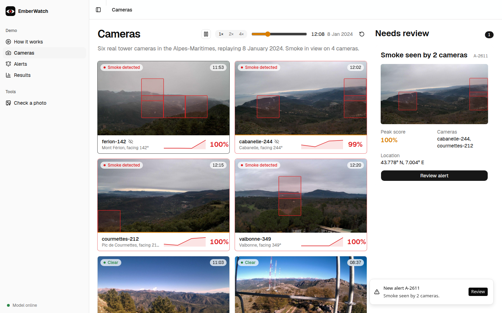
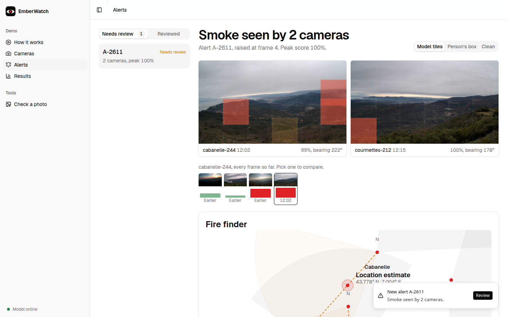
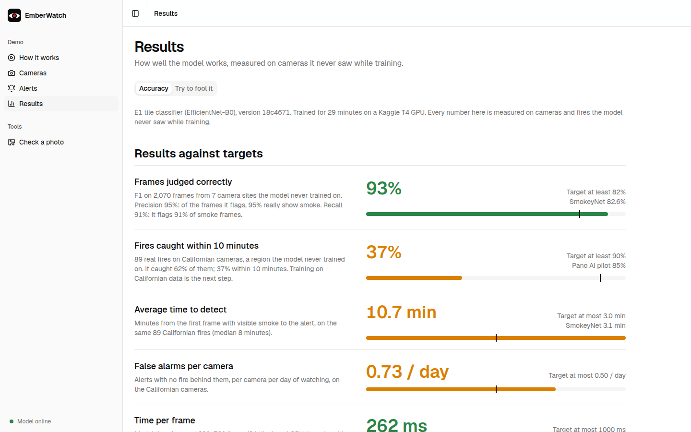
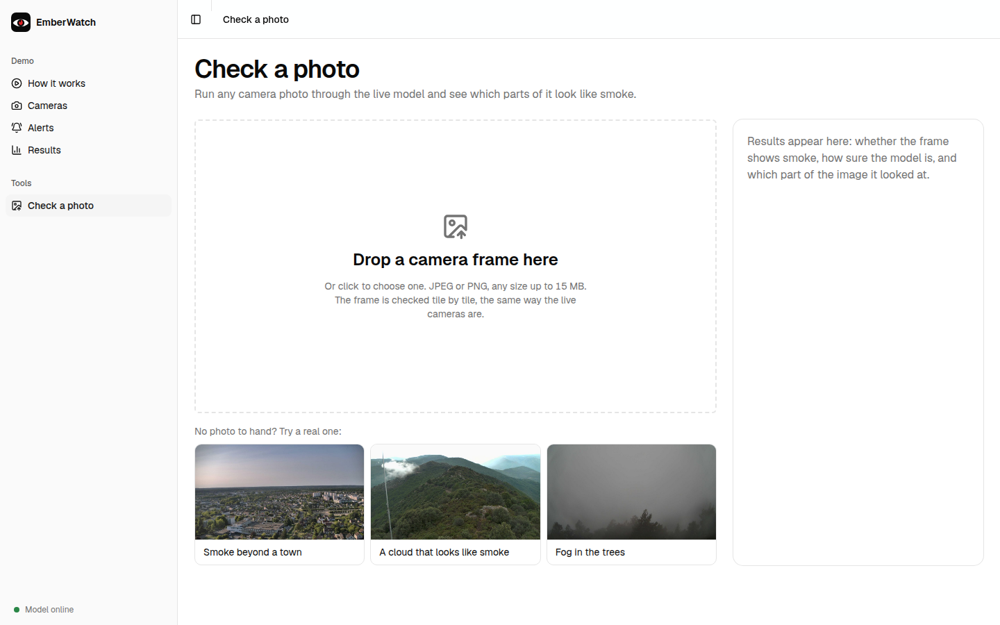

# EmberWatch

**Wildfire smoke early warning from fire-watch tower cameras.** A Keras model checks every camera photo for smoke, a simple rule turns a few smoke photos into one alert, nearby towers' bearings are crossed to estimate where the fire is, and a duty officer confirms or dismisses it before the fire station is called.



## Why

Most wildfires are reported by a 911 call, often 15 minutes or more after the first smoke is visible from a hilltop. Fire services already put cameras on those hilltops. Nobody can watch hundreds of them all day, so a model watches them and a person only looks when it flags something.

## What it does

1. **A tower camera takes a photo**, about every 30 seconds.
2. **The model scores it.** The 1280×720 photo is cut into 24 tiles. An EfficientNet-B0 classifier scores each tile, and the photo's score is its highest tile.
3. **The alert rule confirms it.** A camera alerts when 2 of its last 3 photos (within 15 minutes) score 50% or more. One odd-looking cloud is never enough.
4. **Towers that see the same plume join one alert.** Each camera's bearing to the smoke comes from its heading and where the smoke tile sits in the photo. Where two towers' bearings cross is the location estimate.
5. **A person decides.** The duty officer gets a text as soon as an alert is raised. Confirming it emails the fire station and messages dispatch. Dismissing it needs a reason. Every decision can be undone, and the history is kept.

| Cameras | Alert review |
|---|---|
|  |  |
| **Results** | **Check a photo** |
|  |  |

## Results, honestly

Every number is measured on cameras the model **never saw while training**. The test set holds out whole camera sites, and near-duplicate photos are removed across splits.

| Measure | Result | Target |
|---|---|---|
| Photos judged correctly (F1, 7 unseen French sites, 2,070 photos) | **0.93** (precision 0.95, recall 0.91) | ≥ 0.82 |
| Fires caught within 10 min (89 real Californian fires, FIgLib) | 37% (62% caught at all) | ≥ 90% |
| Average time to detect, on those fires | 10.7 min (median 8) | ≤ 3 min |
| False alarms per camera per day | 0.73 | ≤ 0.5 |
| Time per photo, laptop CPU, ONNX Runtime | 262 ms | ≤ 1 s |

The model works well on the kind of cameras it trained on (France) and falls short on California, a different landscape and camera type. That is the next piece of work: train on Californian data and add a model that looks at several photos in a row. The home page shows one of these misses on purpose ("Faint, far-away smoke").

## How it's built

```
emberwatch/
├── ml/          Keras 3 (JAX) training, evaluation, ONNX export          uv
├── apps/api/    FastAPI, ONNX Runtime, SQLAlchemy + Alembic, SQLite      uv
├── apps/web/    Next.js 16, Tailwind 4, shadcn/ui                        pnpm
├── docs/        research, decisions (ADRs), screenshots
└── scripts/     run training jobs on Kaggle GPUs from the command line
```

Three independent projects in one repo. They share files and HTTP, never code: `ml` exports a versioned `.onnx` model, the API serves it, and the web app calls the API.

- **Training** runs on free Kaggle GPUs. `scripts/kaggle_run.sh` pushes a job that clones this repo at a commit, trains, and the results come back with `fetch`. See [ml/README.md](ml/README.md).
- **Data:** [Pyro-SDIS](https://huggingface.co/datasets/pyronear/pyro-sdis) (French fire services, Apache-2.0) for training. [FIgLib](https://www.hpwren.ucsd.edu/FIgLib/) (HPWREN, non-commercial) only for measuring time to detect, never redistributed.
- **Model store:** each model version lives in `apps/api/models/versions/<version>/` with its checksum. The API refuses a damaged file and records which version scored every photo.
- **Database:** SQLAlchemy 2 models with Alembic migrations, SQLite locally. Moving to Postgres needs a new `EMBERWATCH_DATABASE_URL` and its driver, not code changes.

Key decisions and the reasons for them are in [docs/decisions/](docs/decisions/). Domain terms (onset, plume, time to detect…) are defined in [GLOSSARY.md](GLOSSARY.md).

## Run it

Needs [uv](https://docs.astral.sh/uv/) and [pnpm](https://pnpm.io/).

```bash
# API: http://localhost:8000/docs
cd apps/api
uv sync
uv run alembic upgrade head          # create / update the database
uv run python -m src.seed --reset    # load a real day of camera photos (3 alerts)
uv run fastapi dev src/main.py

# Web: http://localhost:3000
cd apps/web
pnpm install
pnpm dev
```

The API needs a model in `apps/api/models/`; see [apps/api/README.md](apps/api/README.md). Without it, the web app still runs its demos and shows the model as offline.

Tests: `cd apps/api && uv run pytest` (34 tests: alert rule, plume grouping, reviews, model store, migrations, HTTP).

## Credits

Camera images: Pyronear and the French SDIS fire services (Pyro-SDIS, Apache-2.0). Californian fire sequences: HPWREN / UC San Diego (FIgLib), used for evaluation only.
